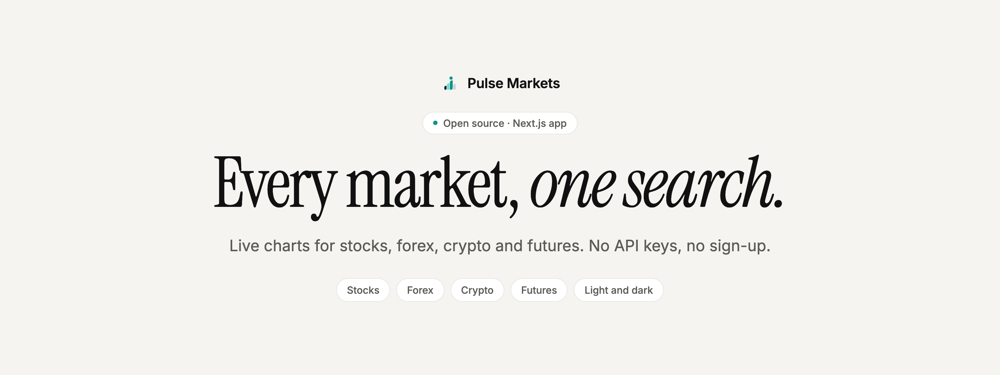
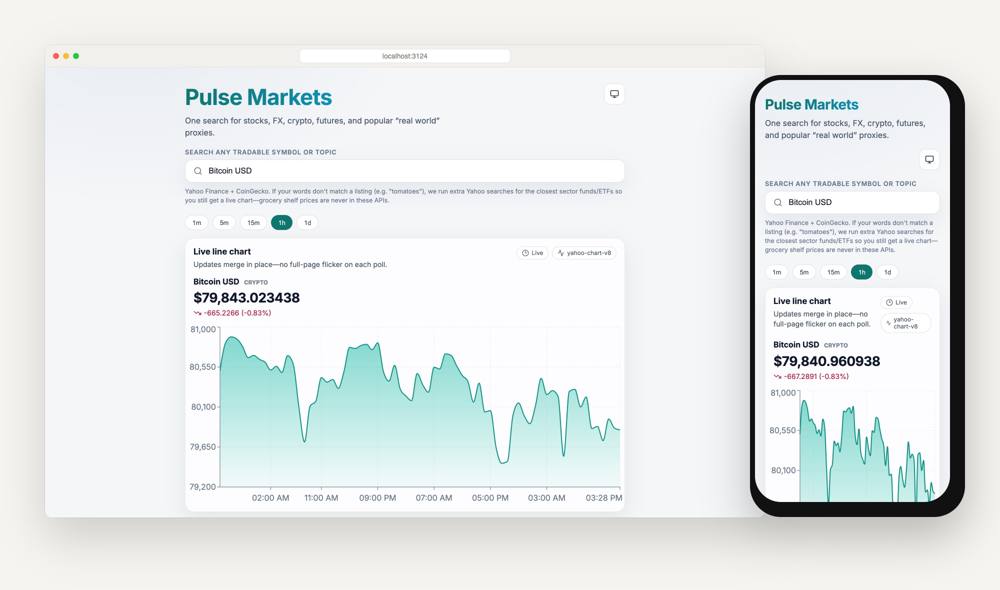
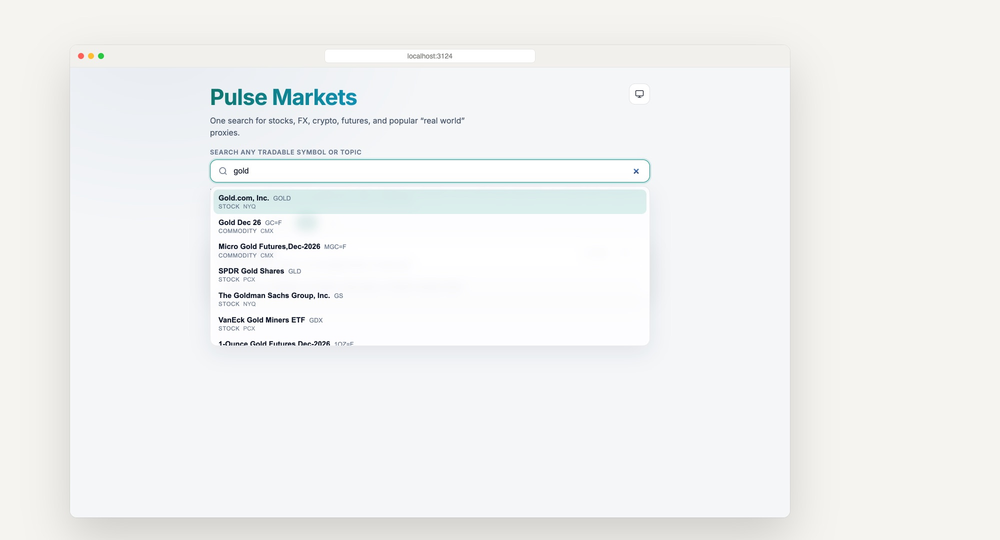
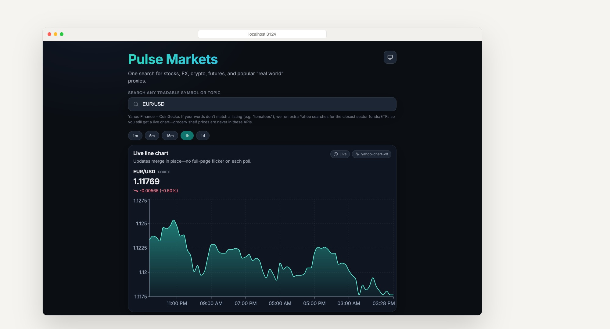
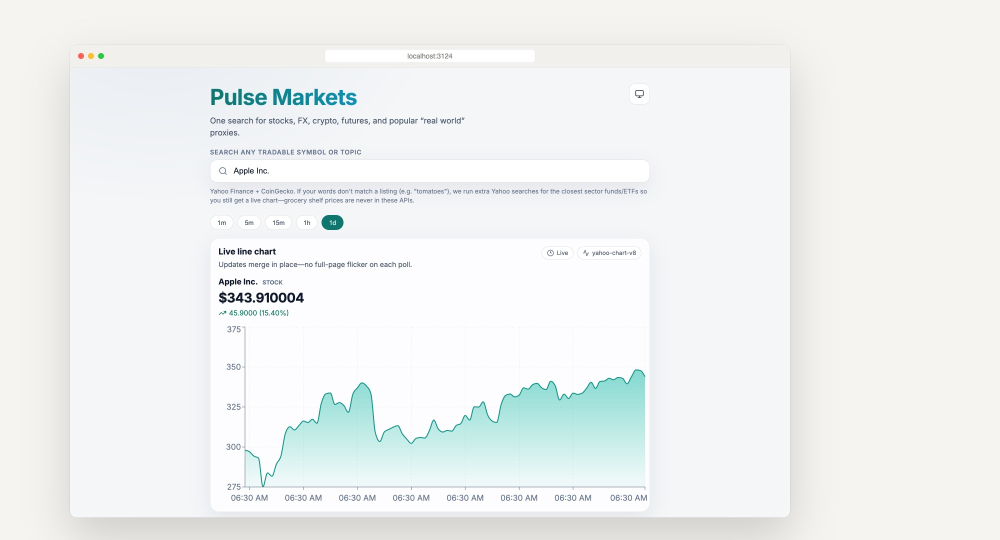

<p align="center">
  <picture>
    <source media="(prefers-color-scheme: dark)" srcset=".github/assets/banner-dark.png">
    
  </picture>
</p>

<p align="center">
  <strong>Type a name. Get a live chart.</strong><br>
  Pulse Markets is a small, open-source Next.js dashboard that finds any tradable instrument from plain words and charts it live, with no keys to set up.
</p>

<p align="center">
  <a href="#quick-start"><strong>Quick start</strong></a> ·
  <a href="#how-it-works"><strong>How it works</strong></a> ·
  <a href="#data-sources"><strong>Data sources</strong></a> ·
  <a href="#honest-status"><strong>Honest status</strong></a>
</p>

<p align="center">
  <a href="LICENSE"></a>
  
  
  
</p>

<p align="center">
  
</p>

## Why Pulse Markets

Checking one price usually means knowing the exact ticker, picking the right site for each asset class, and wading through ads and sign-up walls. Stocks live in one app, currencies in another, crypto in a third.

**Pulse Markets puts them behind a single search box.** Type `Apple`, `gold`, `EUR/USD` or `Bitcoin`, pick a match, and a live chart appears and keeps itself up to date. It runs on your own machine from free public market data, so there is nothing to register for.

<table>
  <tr>
    <td width="33%" valign="top">
      <h3>🔎 One search for everything</h3>
      Stocks, ETFs, forex pairs, futures and crypto in one list, matched from plain words or tickers through Yahoo Finance and CoinGecko search.
    </td>
    <td width="33%" valign="top">
      <h3>📈 Charts that stay live</h3>
      Five ranges from <code>1m</code> to <code>1d</code>. The chart refreshes every 4 to 20 seconds and updates in place, without a full-page flicker.
    </td>
    <td width="33%" valign="top">
      <h3>🔑 Zero setup</h3>
      No API keys, no account, no database. <code>npm install</code>, <code>npm run dev</code>, and you are charting.
    </td>
  </tr>
</table>

## A quick tour

<table>
  <tr>
    <td width="50%" valign="top">
      
      <h4>Search in plain words</h4>
      "gold" finds the stock, the futures contracts and the ETFs, each labelled with its asset class and exchange.
    </td>
    <td width="50%" valign="top">
      
      <h4>Light, dark or system</h4>
      Every view follows your system appearance, or pick one with the toggle in the corner.
    </td>
  </tr>
  <tr>
    <td width="50%" valign="top">
      
      <h4>From minutes to years</h4>
      Switch from one-minute candles for today to daily prices over about two years with one tap.
    </td>
    <td width="50%" valign="top">
      
      <h4>Project artwork</h4>
      <sub>Conceptual cover art, not a product screenshot. <a href="assets/brand/README.md">Design notes and prompts</a>.</sub>
    </td>
  </tr>
</table>

<sub>Screenshots are from the production build running locally on 26 October 2026, with real public market data at that moment.</sub>

## Quick start

**You need:** Node.js 20.9 or newer and npm.

```bash
git clone https://github.com/mihirkavi/Infographics.git
cd Infographics
npm install
npm run dev
```

Open <http://localhost:3000> and start typing in the search box.

| Command | What it does |
| --- | --- |
| `npm run dev` | Development server with hot reload |
| `npm run build` then `npm start` | Production build and server |
| `npm run lint` | ESLint |

## How it works

```text
 search box ──► /api/search ──► Yahoo Finance search (several query variants)
                               └► CoinGecko search (crypto names)
 pick a hit ──► /api/prices ──► stocks · forex · futures ─► Yahoo chart API (v8)
                               └► crypto ─► Binance klines, else Yahoo "-USD"
 chart      ◄── polls every 4–20 s, merges new points in place (Recharts)
```

Both API routes are thin Next.js route handlers. Query parameters are validated with Zod, and errors come back as readable messages in the chart card.

## Data sources

All chart data comes from live public HTTP endpoints. There are no demo or simulated series.

| Asset class | Source | Where |
| --- | --- | --- |
| Stocks, ETFs, forex, futures | Yahoo Finance chart API (`/v8/finance/chart`) | [`src/lib/marketData.ts`](src/lib/marketData.ts) |
| Crypto | Binance public REST (`/api/v3/klines`), falling back to Yahoo `*-USD` symbols | [`src/lib/marketData.ts`](src/lib/marketData.ts) |
| Search | Yahoo Finance search and CoinGecko search | [`src/lib/unifiedSearch.ts`](src/lib/unifiedSearch.ts) |

<details>
<summary><strong>Search behaviour and symbol notes</strong></summary>
<br>

- There is no hardcoded symbol table. Results come from Yahoo search (the query plus variants such as "ETF", "stock" and "futures") merged with CoinGecko matches. For a few everyday topics (for example food or cars) the app also runs extra Yahoo searches for related sector funds, so you still get something chartable.
- Only **tradable** instruments get charts. Shelf prices for groceries or products are not in these APIs.
- Forex symbols look like `EURUSD=X`, futures end in `=F`, and Yahoo crypto pairs look like `BTC-USD`.
- Crypto uses Binance when the pair maps to a `*USDT` market and Binance answers; otherwise it uses Yahoo.
- If you want a richer client, [yahoo-finance2](https://github.com/gadicc/yahoo-finance2) and [CCXT](https://github.com/ccxt/ccxt) are well-known open-source options. Neither is required here.

</details>

## Honest status

Pulse Markets is a personal project, not a trading tool:

- Yahoo's chart and search endpoints are **unofficial**. They can change, rate-limit or break without notice, and their delays apply. This project is not affiliated with or endorsed by Yahoo, Binance or CoinGecko.
- Binance blocks requests from some regions (including the United States). There, crypto charts fall back to Yahoo data, as in the screenshots above.
- Prices are shown with full precision as received, and the daily view's axis labels show times rather than dates.
- There is no hosted demo, no tests and no portfolio, alerts or accounts.
- Nothing here is financial advice.

## Contributing

Issues and pull requests are welcome. Please run `npm run lint` and `npm run build` before opening a pull request.

## License

Released under the [GNU General Public License v3.0](LICENSE).

<p align="center">
  <br>
  <br>
  <sub><strong>Pulse Markets</strong> · Every market, one search.</sub>
</p>
